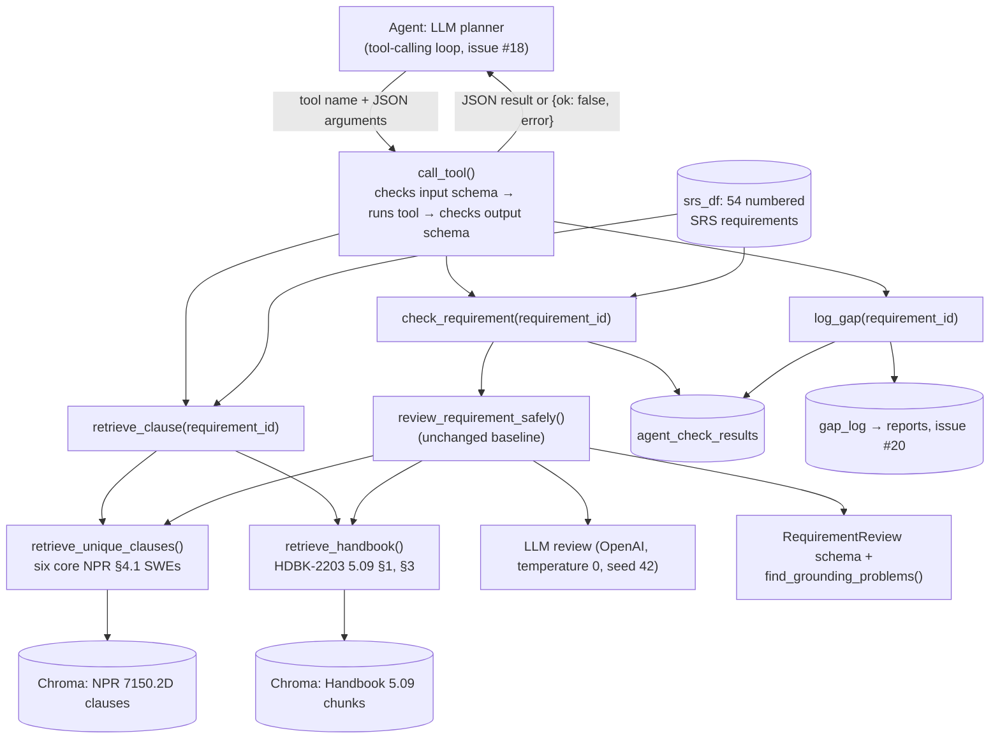

# Agent architecture (issue #17)

The Compliance Copilot agent reuses the non-agentic RAG baseline (October) as its tools. An LLM planner (issue #18) decides which tool to call; each tool is plain Python in `notebooks/Aerospace_1A.ipynb` ("Agent Architecture & Tools" under *November Milestones*) with a Pydantic input and output schema.

## Tools

| Tool | Input | Output | Wraps | LLM calls |
|---|---|---|---|---|
| `retrieve_clause` | `requirement_id`, `k_npr` (1–6, default 6), `k_handbook` (1–10, default 5) | `RetrieveClauseOutput`: requirement text, ranked NPR clauses, ranked Handbook passages | `retrieve_unique_clauses()`, `retrieve_handbook()` | 0 |
| `check_requirement` | `requirement_id` | `CheckRequirementOutput`: `assessed`, `attempts`, `review` (Output Contract `RequirementReview`) | `review_requirement_safely()` | 1–3 |
| `log_gap` | `requirement_id` (must be checked first) | `LogGapOutput`: gap records written, running total | reads `agent_check_results`, writes `gap_log` | 0 |

## Design decisions

1. **IDs, not text.** Tools accept a requirement ID and look up the exact SRS text, so the agent cannot alter or invent a requirement.
2. **Baseline unchanged.** `check_requirement` calls the same `review_requirement_safely()` as the saved 54-requirement runs, so the Baseline vs. Agent comparison (#21) isolates what the agent adds.
3. **Grounded gaps only.** `log_gap` copies quality issues from the saved, validated review; it takes no gap text from the agent.
4. **Strict schemas.** All inputs and outputs reject unknown fields; `call_tool()` validates both directions.
5. **Errors as data.** Refused calls return `{"ok": false, "error": ...}` so the agent can recover.

## What counts as a gap

Output Contract v1 has no Meets / Partial / Gap verdict, so a gap is: (a) each quality issue in a review; (b) a requirement that could not be assessed (all attempts failed); (c) an assessed NEEDS_REVIEW / UNDETERMINED review that lists no specific issue.

## Out of scope for #17

The tool-calling loop (#18), caching and batching (#19), and JSON / Markdown report files (#20).
